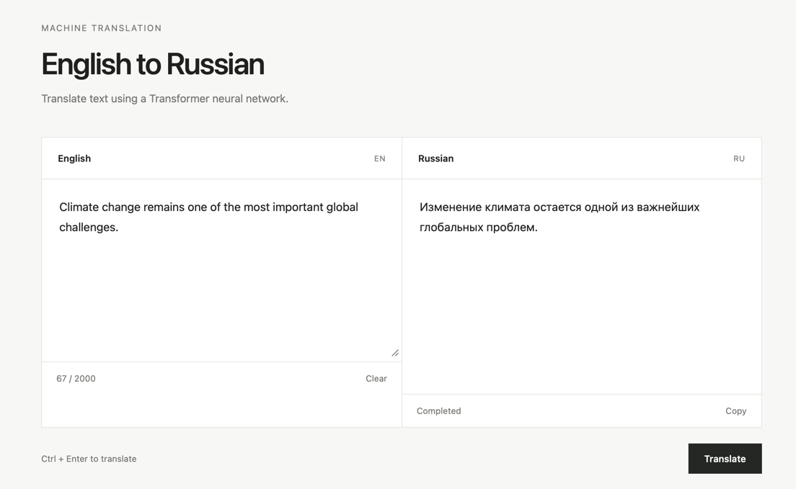

# Transformer Machine Translation (English → Russian)

A neural machine translation system based on the Transformer Encoder–Decoder architecture, implemented using PyTorch.

The project covers the complete machine learning pipeline: data preprocessing, tokenization, model implementation, training, evaluation, inference, and deployment through a REST API with a web interface.

## Results

| Metric | Score |
|---|---:|
| BLEU | 28.97 |
| Test set size | 10,000 sentence pairs |
| Evaluation dataset | MultiUN English–Russian |
| Inference checkpoint | `best_model.pt` |
| Checkpoint selection criterion | Lowest validation loss |

The BLEU score was measured using SacreBLEU on a held-out test set from the MultiUN corpus.

This is an **in-domain evaluation**: the training, validation, and test sets originate from the same corpus. The result should not be interpreted as a measure of translation quality across arbitrary text domains.

## Examples

Translations generated by the trained model:

| English | Russian |
|---|---|
| The meeting will take place on 15 March 2025. | Заседание состоится 15 марта 2025 года. |
| The company reported a significant increase in revenue. | Компания сообщила о значительном увеличении поступлений. |
| Climate change remains one of the most important global challenges. | Изменение климата остается одной из важнейших глобальных проблем. |

### Web Interface




## Architecture

The model implements the Transformer Encoder–Decoder architecture.

### Encoder

- Token embeddings
- Positional encoding
- Multi-head self-attention
- Position-wise feed-forward networks
- Residual connections
- Layer normalization

### Decoder

- Token embeddings
- Positional encoding
- Masked multi-head self-attention
- Encoder–Decoder attention
- Position-wise feed-forward networks
- Residual connections
- Layer normalization

The model uses autoregressive decoding to generate translations token by token.

### Model Configuration

| Parameter | Value |
|---|---:|
| Model dimension (`d_model`) | 256 |
| Attention heads | 4 |
| Encoder layers | 4 |
| Decoder layers | 4 |
| Feed-forward dimension | 1024 |
| Dropout | 0.1 |
| Maximum sequence length | 256 |
| Source vocabulary | 24,000 |
| Target vocabulary | 24,000 |

## Dataset

The model was trained on the MultiUN English–Russian parallel corpus.

The dataset contains approximately 1 million sentence pairs:

| Split | Sentence pairs |
|---|---:|
| Training | 980,000 |
| Validation | 10,000 |
| Test | 10,000 |
| **Total** | **1,000,000** |

The preprocessing pipeline includes:

- Text preprocessing
- Sentence pair preparation
- SentencePiece tokenization
- Sequence encoding
- Padding and masking

Separate SentencePiece tokenizers are used for English and Russian, each with a vocabulary size of 24,000 tokens.

## Training

The Transformer model was trained on the MultiUN parallel corpus using PyTorch.

### Training Configuration

| Parameter | Value |
|---|---:|
| Optimizer | AdamW |
| Learning rate | 0.0003 |
| Weight decay | 0.0001 |
| Batch size | 32 |
| Completed epochs | 32 |
| Configured maximum epochs | 40 |
| Loss function | Cross-Entropy Loss |
| Gradient clipping | 1.0 |
| Random seed | 42 |
| Learning rate scheduler | None |
| Warmup | None |
| GPU | NVIDIA GeForce RTX 4060 (8 GB VRAM) |

Padding tokens are excluded from loss calculation using `ignore_index`.

The model is evaluated on the validation set after each epoch. The checkpoint with the lowest validation loss is saved as `best_model.pt`.

Training was stopped after 32 completed epochs. The project uses separate checkpoints for inference and training resumption:

- `best_model.pt` stores the checkpoint with the lowest validation loss and is used for inference and evaluation.
- `last_model.pt` stores the checkpoint from the final completed training epoch and can be used to resume training.

## Limitations

The model's translation quality depends on the domain and linguistic patterns represented in the training data.

The MultiUN corpus primarily consists of official documents and UN-related texts. Consequently, the model may struggle with vocabulary, expressions, and linguistic constructions that are less represented in the training corpus.

For example, the following input comes from outside the dominant domain of the training data:

**Input:**

```text
Scientists have discovered a new method of treatment.
```

**Model output:**

```text
Стенциаристские копы обнаружили новый метод обращения.
```

This example illustrates the model's limited generalization to unfamiliar linguistic patterns and domains outside its training distribution.

This behavior does not necessarily indicate a tokenization failure. SentencePiece can represent many previously unseen words as sequences of known subword units, but this does not guarantee that the model has learned their correct meanings or translations.

Other limitations include:

- Autoregressive decoding may produce repetitive or incorrect outputs.
- The model has not been systematically evaluated on independent out-of-domain datasets.
- Its performance has not yet been benchmarked against large pretrained translation models.
- The BLEU score alone does not fully represent translation quality or semantic adequacy.

## Technologies

- Python
- PyTorch
- SentencePiece
- FastAPI
- Uvicorn
- SacreBLEU

## Project Structure

```text
transformer-machine-translation/
├── src/
│   ├── data/
│   │   ├── dataset.py
│   │   ├── dataloader.py
│   │   └── tokenizer.py
│   ├── evaluation/
│   │   ├── evaluate.py
│   │   ├── translate.py
│   │   └── compare_train_test.py
│   ├── model/
│   │   ├── attention.py
│   │   ├── decoder.py
│   │   ├── embeddings.py
│   │   ├── encoder.py
│   │   ├── feed_forward.py
│   │   ├── masks.py
│   │   ├── positional_encoding.py
│   │   └── transformer.py
│   ├── training/
│   │   ├── train.py
│   │   ├── run.py
│   │   └── benchmark.py
│   ├── config.py
│   └── api.py
├── tests/
├── tokenizers/
├── static/
├── requirements.txt
├── requirements-dev.txt
└── README.md
```

## Installation

### Clone the repository

```bash
git clone https://github.com/LLangreSS/transformer-machine-translation.git

cd transformer-machine-translation
```

### Create a virtual environment

```bash
python -m venv .venv
```

### Activate the environment

**macOS / Linux**

```bash
source .venv/bin/activate
```

**Windows (PowerShell)**

```powershell
.venv\Scripts\Activate.ps1
```

### Install dependencies

```bash
pip install -r requirements.txt
```

## Model Checkpoints

Pretrained model checkpoints are hosted on Hugging Face and are not included in the GitHub repository.

**Hugging Face Model Repository:**

https://huggingface.co/LeshaGolosha/transformer-machine-translation

The repository contains two checkpoints:

- `best_model.pt` — checkpoint with the lowest validation loss. Used for inference and evaluation.
- `last_model.pt` — checkpoint saved after the 32nd training epoch. Intended for resuming training.

### Download the inference checkpoint

Install the Hugging Face CLI:

```bash
pip install -U huggingface_hub
```

Download `best_model.pt`:

```bash
hf download LeshaGolosha/transformer-machine-translation \
    best_model.pt \
    --local-dir checkpoints
```

The checkpoint will be saved to:

```text
checkpoints/best_model.pt
```

## Inference

After downloading the checkpoint, run the translation interface:

```bash
python -m src.evaluation.translate
```

The model accepts English text and generates a Russian translation.

## Web Interface

Start the API server:

```bash
uvicorn src.api:app --reload
```

Open the application in your browser:

http://127.0.0.1:8000

The application provides English-to-Russian translation through a REST API and a web interface.

## Evaluation

Run the evaluation script:

```bash
python -m src.evaluation.evaluate
```

Evaluation is performed on the held-out test dataset using `best_model.pt`.

The project uses SacreBLEU to calculate the BLEU metric.

## Tests

Install development dependencies:

```bash
pip install -r requirements-dev.txt
```

Run the test suite:

```bash
pytest
```

The tests cover model components, data processing, training, validation, tokenization, and checkpoint handling.

## Future Work

- Evaluate the model on an independent out-of-domain dataset, such as FLORES-200.
- Compare performance with a pretrained English–Russian translation model such as OPUS-MT.
- Analyze potential train/test overlap and duplicate sentence pairs.
- Record training runtime and detailed hardware specifications.
- Experiment with decoding strategies and model hyperparameters.
- Improve generalization to conversational and general-purpose text.

## Author

Developed as a machine learning portfolio project to explore Transformer architecture, neural machine translation, and the complete model development pipeline.