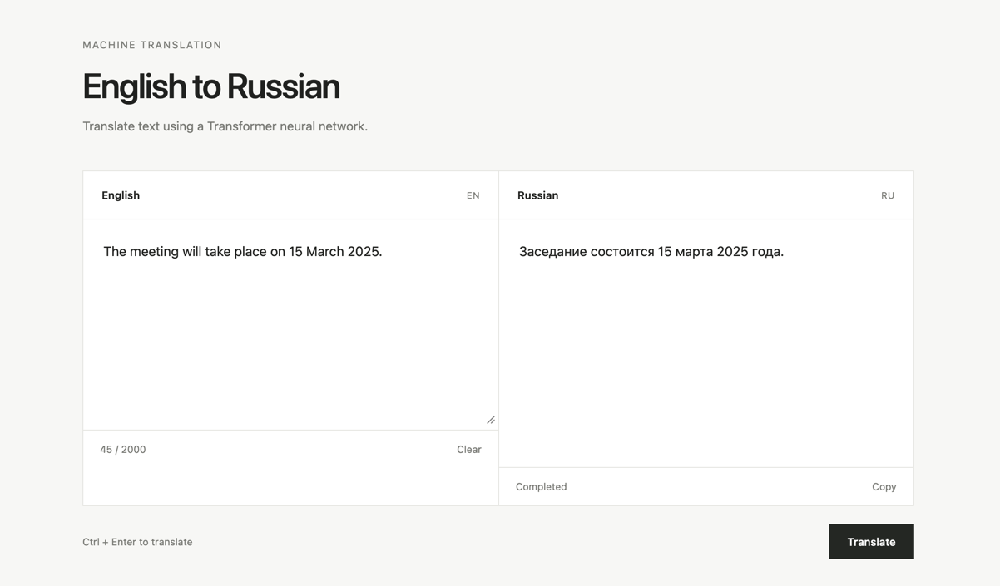

# Transformer Machine Translation (English → Russian)

A neural machine translation system based on the Transformer Encoder–Decoder architecture, implemented from scratch using PyTorch.

The project covers the complete machine learning pipeline: data preprocessing, tokenization, model training, evaluation, inference, and deployment through a REST API with a web interface.

## Results

| Metric | Score |
|---|---:|
| BLEU | 28.97 |

BLEU score was measured on the held-out test set of 10,000 sentence pairs.

## Examples

Translations generated by the trained model:

| English | Russian |
|---|---|
| The meeting will take place on 15 March 2025. | Заседание состоится 15 марта 2025 года. |
| The company reported a significant increase in revenue. | Компания сообщила о значительном увеличении поступлений. |
| Climate change remains one of the most important global challenges. | Изменение климата остается одной из важнейших глобальных проблем. |
| The government announced new economic reforms. | Новое правительство объявило о проведении экономических реформ. |




### Limitations

The model may produce incorrect translations for unfamiliar words
and complex linguistic constructions.

Example:

**Input:** Scientists have discovered a new method of treatment.

**Output:** Стенциаристские копы обнаружили новый метод обращения.

This demonstrates limitations in vocabulary generalization
and translation quality on sentences outside the model's familiar patterns.

## Architecture

The model implements the Transformer Encoder–Decoder architecture.

### Encoder
- Token embeddings
- Positional encoding
- Multi-head self-attention
- Position-wise feed-forward networks
- Residual connections
- Layer normalization

### Decoder
- Token embeddings
- Positional encoding
- Masked multi-head self-attention
- Encoder–Decoder attention
- Position-wise feed-forward networks
- Residual connections
- Layer normalization

The model uses autoregressive decoding to generate translations token by token.

### Model Configuration

| Parameter | Value |
|---|---:|
| Model dimension (`d_model`) | 256 |
| Attention heads | 4 |
| Encoder layers | 4 |
| Decoder layers | 4 |
| Feed-forward dimension | 1024 |
| Dropout | 0.1 |
| Maximum sequence length | 256 |
| Source vocabulary | 24,000 |
| Target vocabulary | 24,000 |

## Dataset

The model was trained on the English–Russian parallel corpus MultiUN.

The dataset contains approximately 1 million sentence pairs, split into three subsets:

| Split | Sentence pairs |
|---|---:|
| Training | 980,000 |
| Validation | 10,000 |
| Test | 10,000 |
| **Total** | **1,000,000** |

The preprocessing pipeline includes:
- Text preprocessing
- Sentence pair preparation
- SentencePiece tokenization
- Sequence encoding
- Padding and masking

Separate SentencePiece tokenizers are used for English and Russian, each with a vocabulary size of 24,000 tokens.

## Technologies

- Python
- PyTorch
- SentencePiece
- FastAPI
- Uvicorn
- SacreBLEU

## Project Structure

```text
transformer-machine-translation/
├── src/
│   ├── data/
│   │   ├── dataset.py
│   │   ├── dataloader.py
│   │   └── tokenizer.py
│   ├── evaluation/
│   │   ├── evaluate.py
│   │   ├── translate.py
│   │   └── compare_train_test.py
│   ├── model/
│   │   ├── attention.py
│   │   ├── decoder.py
│   │   ├── embeddings.py
│   │   ├── encoder.py
│   │   ├── feed_forward.py
│   │   ├── masks.py
│   │   ├── positional_encoding.py
│   │   └── transformer.py
│   ├── training/
│   │   ├── train.py
│   │   ├── run.py
│   │   └── benchmark.py
│   ├── config.py
│   └── api.py
├── tests/
├── tokenizers/
├── static/
├── requirements.txt
├── requirements-dev.txt
└── README.md
```

## Installation

Clone the repository:

```bash
git clone https://github.com/LLangreSS/transformer-machine-translation.git

cd transformer-machine-translation
```

Create a virtual environment:

```bash
python -m venv .venv
```

Activate it:

**macOS / Linux**

```bash
source .venv/bin/activate
```

Install dependencies:

```bash
pip install -r requirements.txt
```

## Inference

Pretrained model checkpoints are not included in the repository.

Place the trained checkpoint in the `checkpoints/` directory according to the project configuration.

Run the translation interface:

```bash
python -m src.evaluation.translate
```

The model accepts English text and generates a Russian translation.

## Web Interface

Start the API server:

```bash
uvicorn src.api:app --reload
```

Open the web interface in your browser.

The application provides English-to-Russian translation through a REST API and a simple web interface.

## Evaluation

The project supports evaluation using BLEU through SacreBLEU.

```bash
python -m src.evaluation.evaluate
```

Evaluation is performed on the held-out test dataset.

## Tests

Install development dependencies:

```bash
pip install -r requirements-dev.txt
```

Run the test suite:

```bash
pytest
```

The tests cover model components, data processing, training, validation, tokenization, and checkpoint handling.

## Limitations

- Translation quality depends on the training data domain.
- Autoregressive decoding may produce repetitive or incorrect outputs.
- The model is not intended to match the performance of large pretrained translation models.
- Model checkpoints are not distributed with the repository.

## Author

Developed as a machine learning portfolio project to explore Transformer architecture, neural machine translation, and the complete model development pipeline.
